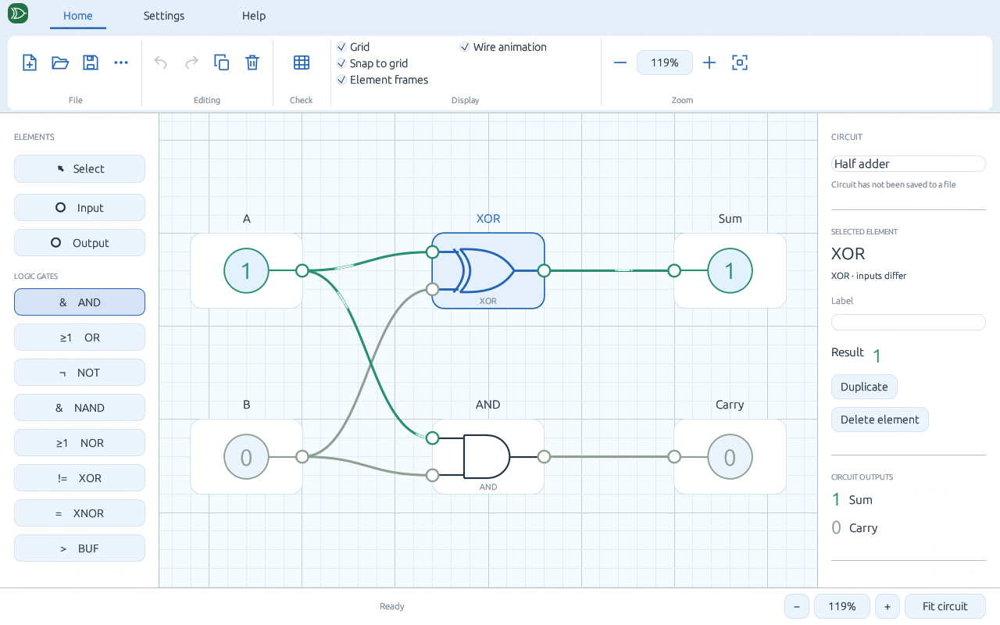

<p align="center"></p>

<p align="center"><a href="README.md">Русский</a> · <strong>English</strong> · <a href="https://github.com/MrDenlol/XOR-112/releases">Download</a> · <a href="https://github.com/MrDenlol/XOR-112/actions">Build status</a></p>

**XOR-112** is a native Rust desktop editor for binary combinational logic. Build circuits from gates, toggle their inputs and see outputs update immediately. Its **32-bit and 64-bit ALUs are fully expanded, editable gate circuits**: every gate and wire can be changed.



## Features

- AND, OR, NOT, NAND, NOR, XOR, XNOR and BUF gates, plus input switches and output indicators.
- Drag, rename, connect, duplicate and delete elements; undo and redo.
- Line grid, snapping, zoom, optional element frames and animated active wires.
- Connection validation and truth tables for circuits with up to eight inputs.
- Half-adder, full-adder and editable 32-bit / 64-bit ALU examples.
- Save/load using the open `.binary` JSON format.
- Russian and English interface; green, blue and gray themes; persistent display settings.

All signal values and operands are binary. The app runs locally without a server.

## Windows download

Download a Windows x64 ZIP from [Releases](https://github.com/MrDenlol/XOR-112/releases), extract it and run **`xor-112.exe`**. Rust is not needed to run a packaged build. An OpenGL 3.3 graphics driver is required. If no release is available yet, build from source below.

Toggle A and B in the initial half-adder. Open **Home → ⋯** for other examples, and **Settings** to change language/theme. Press **F1** for shortcuts. Save your work with **Ctrl+S**; circuits are not autosaved.

## Editable ALUs

| Width | Elements | One-bit wires |
|---|---:|---:|
| 32 bits | 18,777 | 37,263 |
| 64 bits | 73,617 | 146,671 |

Operation codes: `000` addition, `001` subtraction, `010` multiplication, `011` integer division, `100` integer square root (rounded down). Operands are unsigned. R holds the result; HI holds the upper product word; REM holds the remainder. Carry, borrow, overflow, divide-by-zero, invalid-code and validity flags are exposed. Unsupported codes and division by zero return zero data with invalid status.

The shared gate evaluator computes every operation. There is no hidden arithmetic block in these examples. Use section navigation or element-name search to inspect and edit the large circuit.

## Build from source

Use Rust stable and your platform's native build tools:

```sh
cargo test --release --locked
cargo build --release --locked
cargo run --release --locked
```

Windows: Visual Studio Build Tools (C++ and Windows SDK) with Rust MSVC, or MinGW-w64 with Rust GNU. Output: `target/release/xor-112.exe`.

Ubuntu/Debian dependencies:

```sh
sudo apt install build-essential pkg-config libx11-dev libxkbcommon-dev libwayland-dev libgl1-mesa-dev libxcursor-dev libxi-dev libxrandr-dev xdg-desktop-portal xdg-desktop-portal-gtk
```

macOS requires Xcode Command Line Tools. Linux/macOS output: `target/release/xor-112`. Windows was tested locally; [Actions](https://github.com/MrDenlol/XOR-112/actions) reports the actual results for all three platforms. Linux/macOS packaging is not provided as a signed installer.

Examples are built into the application. Generate standalone files with:

```sh
cargo run --release --locked --example export_examples
```

Generated files appear in `examples/circuits/` and are included in the release archive. You can also pass a `.binary` file as the first command-line argument.

## Scope and documentation

This is a combinational logic simulator: electrical characteristics, propagation delays, clocks, flip-flops and memory are outside this version's scope. Cycles are rejected. Large circuits use a simplified overview and six undo snapshots.

Settings are stored under `XOR-112/settings.json` in Windows AppData, Linux XDG config or macOS Application Support. Existing `BinaryLogic` preferences are copied on first launch if no XOR-112 settings exist. Circuits remain compatible with the previous supported file versions.

See the [Russian user guide](docs/USER_GUIDE.ru.md), [architecture](docs/ARCHITECTURE.md), [testing](docs/TESTING.md), [changelog](CHANGELOG.md) and [contribution guide](CONTRIBUTING.md).

## License

[MIT](LICENSE). Dependency notices are in [THIRD_PARTY_NOTICES.txt](THIRD_PARTY_NOTICES.txt). No third-party textbook or reference photograph is distributed with this project.
