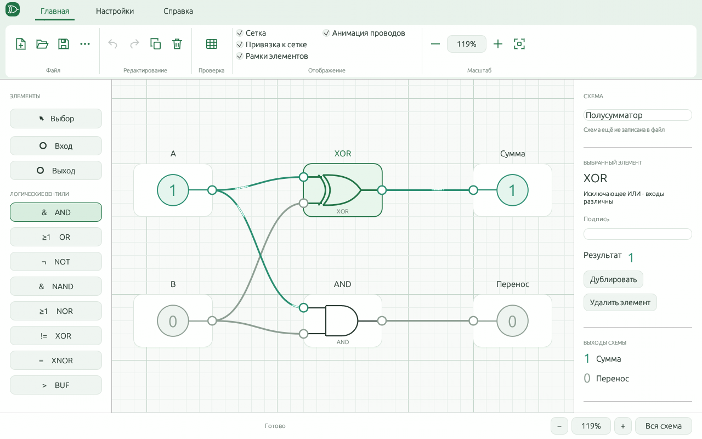
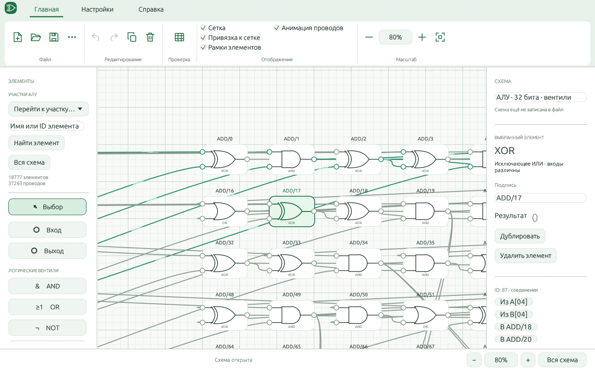

<p align="center"></p>

<p align="center">
  <a href="https://github.com/MrDenlol/XOR-112/actions/workflows/build.yml"></a>
  <a href="LICENSE"></a>
  
  
</p>

<p align="center"><strong>Русский</strong> · <a href="README.en.md">English</a> · <a href="https://github.com/MrDenlol/XOR-112/releases">Скачать</a> · <a href="docs/USER_GUIDE.ru.md">Руководство</a> · <a href="https://github.com/MrDenlol/XOR-112/issues">Обратная связь</a></p>

**XOR-112** — настольная среда для создания и исследования бинарных логических схем. Соединяйте вентили, переключайте входы и сразу наблюдайте результат. Встроенные АЛУ на **32 и 64 бита** полностью развёрнуты: каждый вентиль и каждый провод доступны для редактирования.



## Возможности

| | Что доступно |
|---|---|
| Логика | AND, OR, NOT, NAND, NOR, XOR, XNOR, BUF; входы и выходы |
| Редактор | Перетаскивание, переименование, соединения, удаление, дублирование, отмена и повтор |
| Холст | Линейная сетка, привязка, масштаб, отключаемые рамки, анимация активных проводов |
| Проверка | Расчёт комбинационных схем, диагностика связей, таблица истинности до восьми входов |
| Примеры | Полусумматор, полный сумматор, развёрнутые АЛУ на 32 и 64 бита |
| Файлы | Сохранение и загрузка схем `.binary` — открытый формат JSON |
| Оформление | Лента команд, русский и английский языки, зелёная, синяя и серая темы |
| Настройки | Язык, тема, масштаб и параметры отображения сохраняются между запусками |

Приложение работает локально. Сигналы и операнды отображаются только в двоичном виде; десятичного и шестнадцатеричного режима нет.

## Запуск в Windows

1. Откройте [Releases](https://github.com/MrDenlol/XOR-112/releases) и скачайте Windows x64 ZIP.
2. Распакуйте весь архив в отдельную папку.
3. Запустите **`xor-112.exe`**. Установка Rust не нужна.
4. Нажмите на вход A или B в полусумматоре. Для большого примера выберите **Главная → ⋯ → Пример: АЛУ**.

Требуется 64-битная Windows и графический драйвер с OpenGL 3.3. Если готового релиза ещё нет, используйте сборку из исходников ниже. Приложение не сохраняет схемы автоматически: используйте **Ctrl+S**. Справка по клавишам открывается **F1**.

## АЛУ, которое можно разобрать



| Пример | Вентили и входы/выходы | Однобитные соединения |
|---|---:|---:|
| АЛУ на 32 бита | 18 777 | 37 263 |
| АЛУ на 64 бита | 73 617 | 146 671 |

| Код | Операция | Результат |
|---|---|---|
| `000` | Сложение | R и перенос |
| `001` | Вычитание | R по модулю разрядности и заём |
| `010` | Умножение | Полное произведение HI:R |
| `011` | Целое деление | Частное R и остаток REM |
| `100` | Квадратный корень | Целый корень вниз в R; остаток в REM |

Операнды беззнаковые. Деление на ноль и неизвестные коды диагностируются отдельными флагами. Вычисления выполняет общий симулятор вентилей; изменение соединений меняет результат. На общем плане используйте **«Перейти к участку…»**, затем приближайте отдельные вентили.

## Сборка

Установите Rust stable и нативные средства сборки для своей ОС. Из корня репозитория:

```sh
cargo test --release --locked
cargo build --release --locked
cargo run --release --locked
```

Windows: Rust MSVC с Visual Studio Build Tools (C++ и Windows SDK) либо Rust GNU с MinGW-w64. Результат — `target/release/xor-112.exe`.

Linux (Ubuntu/Debian):

```sh
sudo apt install build-essential pkg-config libx11-dev libxkbcommon-dev libwayland-dev libgl1-mesa-dev libxcursor-dev libxi-dev libxrandr-dev xdg-desktop-portal xdg-desktop-portal-gtk
cargo build --release --locked
```

macOS: установите Xcode Command Line Tools, затем выполните те же команды Cargo. Linux/macOS: `target/release/xor-112`. Проверки для трёх ОС настроены в [GitHub Actions](https://github.com/MrDenlol/XOR-112/actions); фактический результат сборок виден там. Локально проверена Windows-сборка.

Примеры встроены в программу. Для получения отдельных файлов всех схем:

```sh
cargo run --release --locked --example export_examples
```

Они появятся в `examples/circuits/`. Большие АЛУ генерируются из исходников и включаются в архив релиза.

## Документация и участие

- [Подробное руководство](docs/USER_GUIDE.ru.md): управление, формат файлов, АЛУ и ограничения.
- [Устройство проекта](docs/ARCHITECTURE.md) и [проверки](docs/TESTING.md).
- [История версий](CHANGELOG.md), [правила участия](CONTRIBUTING.md), [сообщить об ошибке](https://github.com/MrDenlol/XOR-112/issues/new/choose).

Это симулятор **комбинационной** логики: без электрических параметров, задержек, тактовых сигналов, триггеров и памяти. Обратные связи отклоняются. На малом масштабе большая схема показывается упрощённо; история крупных схем ограничена шестью действиями.

## Лицензия

[MIT](LICENSE). Лицензии зависимостей собраны в [THIRD_PARTY_NOTICES.txt](THIRD_PARTY_NOTICES.txt). Проект использует общеизвестные принципы булевой алгебры и цифровой схемотехники; учебники и сторонние фотографии не входят в поставку.
